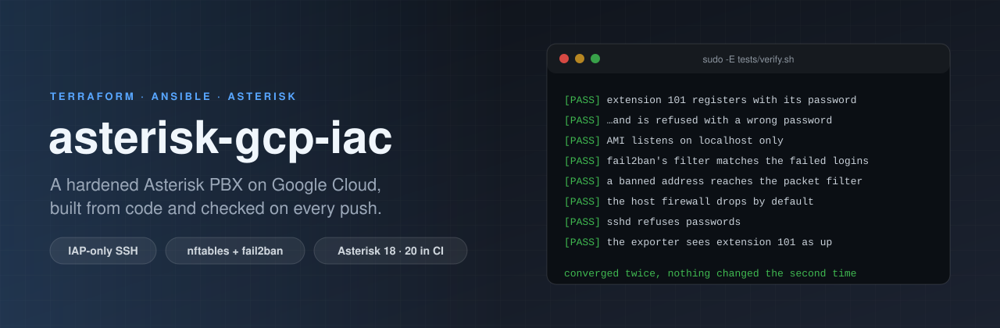
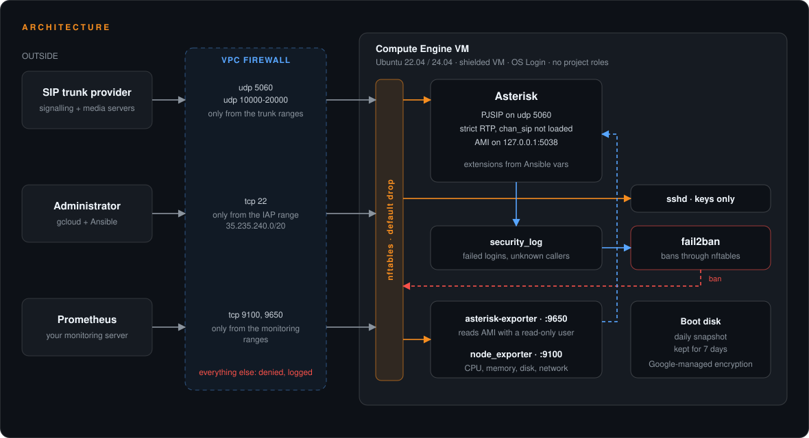

<p align="center">
  
</p>

<p align="center">
  <a href="https://github.com/ErenOzgu/asterisk-gcp-iac/actions/workflows/ci.yml"></a>
  
  
  
  <a href="LICENSE"></a>
</p>

Terraform builds the Google Cloud side of a small Asterisk PBX: a locked-down network, one shielded VM and a static address. Ansible then configures the machine: Asterisk with PJSIP, a host firewall, fail2ban watching Asterisk's security log, and Prometheus metrics through [asterisk-exporter](https://github.com/ErenOzgu/asterisk-exporter).

It is meant as a sound starting point, not a turnkey call centre. The interesting part is what is *not* open: nothing answers on the internet except SIP from the addresses you list, and nobody logs in with a key file.

<p align="center">
  
</p>

## What you get

| Layer | What it does |
|---|---|
| **VPC and firewall** | A custom network with its own subnet (flow logs on). Every rule is scoped to the PBX's network tag and logs. SIP `udp/5060` and RTP `udp/10000-20000` are open only to ranges you list, SSH only to Google's IAP range, metrics only to your Prometheus. A logging deny-all rule closes the rest. |
| **VM** | Shielded VM (secure boot, vTPM, integrity monitoring), OS Login, project-wide SSH keys blocked, serial console off, no IP forwarding, deletion protection on. Boot disk snapshotted daily, kept for a week. |
| **Identity** | The VM runs as its own service account **with no roles at all**, so nothing on it can call a Google API. Admins get OS Login, an IAP tunnel and the right to act as that account, as IAM grants. |
| **Host firewall** | `nftables`, default drop, the same source lists as the VPC rules. A second layer: a mistake in one is not an open port. |
| **Asterisk** | PJSIP only (legacy `chan_sip`, IAX, Skinny, MGCP and UniStim are not loaded), strict RTP, AMI on `127.0.0.1`, the security log switched on, extensions generated from variables. |
| **fail2ban** | Reads Asterisk's security log and bans through `nftables`. The SSH jail is off on purpose: every admin login arrives from IAP's addresses, so a few typos would ban everyone. |
| **Monitoring** | `node_exporter` and `asterisk-exporter` (pinned release, checksum verified, systemd-hardened) behind a read-only AMI user. |

## Quick start

You need Terraform 1.5+, `ansible-core` 2.18+, `jq`, and `gcloud` logged in as an owner of the project.

```bash
gcloud services enable compute.googleapis.com iap.googleapis.com oslogin.googleapis.com

# 1. The cloud side
cd terraform
cp terraform.tfvars.example terraform.tfvars   # project_id, sip_source_ranges, admin_members
terraform init
terraform apply

# 2. Let Ansible find the VM (through an IAP tunnel, with your OS Login user)
cd ..
$(cd terraform && terraform output -raw ssh_command)    # first login: creates and registers your key
make inventory

# 3. Passwords for the extensions and the exporter, then configure the machine
cp ansible/group_vars/asterisk/vault.yml.example ansible/group_vars/asterisk/vault.yml
$EDITOR ansible/group_vars/asterisk/vault.yml            # openssl rand -base64 24 for each value
ansible-vault encrypt ansible/group_vars/asterisk/vault.yml
$EDITOR ansible/group_vars/asterisk/main.yml             # firewall_sip_sources, extensions
make deploy

# 4. Optional: run the checks CI runs, on the VM itself
gcloud compute scp --recurse tests <instance>:/tmp/ --zone <zone> --project <project> --tunnel-through-iap
$(cd terraform && terraform output -raw ssh_command) -- "EP101_PASSWORD='<101 password>' sudo -E bash /tmp/tests/verify.sh"
```

Point a softphone at `<external_ip>:5060` with extension `101` and its password, and dial `600` to hear the echo test, or dial `102` once a second phone is registered.

To tear everything down: `terraform apply -var deletion_protection=false`, then `terraform destroy`.

### Settings you will touch

| Where | Variable | Meaning |
|---|---|---|
| `terraform.tfvars` | `sip_source_ranges` | **Required.** Who may reach SIP: your trunk provider's addresses and your own. No default; `0.0.0.0/0` is refused unless `allow_open_sip = true`. |
| | `rtp_source_ranges` | Media sources, if they differ from the SIP ones. |
| | `monitoring_source_ranges` | Your Prometheus. Empty keeps the metrics ports closed. |
| | `admin_members` | Who may SSH in (`user:you@example.com`). |
| | `machine_type`, `region`, `zone` | Defaults: `e2-small` in `europe-west3`. |
| `group_vars/asterisk/main.yml` | `firewall_sip_sources` | Same list as above, for the host firewall. |
| | `asterisk_endpoints` | Extensions: name, password (from the vault) and an optional caller ID. |
| | `monitoring_exporter_version` | Release of asterisk-exporter to install. |

## How it is tested

Everything below runs on every push.

| Job | What it proves |
|---|---|
| **Terraform** | `fmt`, `validate`, then a real `terraform plan` without credentials, which creates nothing. The plan is turned into JSON and checked against **17 promises** ([`check_plan.sh`](terraform/tests/check_plan.sh)): no allow rule open to the world, SSH from the IAP range only, shielded VM, OS Login, no project roles for the service account, snapshots, and so on. **Nine bad or borderline inputs** ([`negative.sh`](terraform/tests/negative.sh)) must be refused with the module's own messages. Then `tflint` and Checkov. |
| **Ansible lint** | `ansible-lint` on the *production* profile, `yamllint`, `shellcheck`, a syntax check. |
| **Converge** on Ubuntu 22.04 and 24.04 | The playbook runs against a real Ubuntu VM with systemd (the GitHub runner): real `apt`, real units, real `nftables` and fail2ban. Then [`verify.sh`](tests/verify.sh) checks the result, **and the playbook runs a second time and must report `changed=0`**. |

[`verify.sh`](tests/verify.sh) does not just look at config files. It registers extension 101 with a SIP digest login, checks that a wrong password and an unknown extension are refused, that those refusals show up in Asterisk's security log and match fail2ban's filter, that a ban reaches the packet filter, that the AMI port is bound to localhost only, that the firewall's default is drop, and that the exporter sees the registered phone as up.

**What CI cannot do:** `terraform apply` against a real project (that needs billing and credentials), and run the playbook on a Compute Engine VM. The runner is an Ubuntu VM, not a GCE instance, so GCE-specific behaviour (OS Login, the IAP tunnel itself) is covered by the design and the documentation, not by a test.

## Layout

```text
terraform/                 VPC, firewall, VM, service account, snapshots, IAM
  tests/                   plan policy checks, refused-input checks, CI variables
ansible/
  site.yml                 common, firewall, asterisk, fail2ban, monitoring
  roles/                   one role per concern, templates next to the tasks
  group_vars/              your settings (secrets go in vault.yml, never committed)
scripts/make-inventory.sh  Terraform outputs to an IAP-ready Ansible inventory
tests/verify.sh            end-to-end checks on a converged host
```

## Limits

- **One VM.** No high availability and no failover address. A snapshot restores the disk; it does not keep calls up.
- **SIP over UDP, no TLS.** Extensions authenticate with digest passwords over UDP, as most trunks do. Adding a TLS transport and certificates is the obvious next step.
- **No trunk configuration.** The dialplan covers extensions and an echo test. Trunks depend on your provider, so the roles stop at `[internal]`.
- **Local Terraform state.** Add a `backend "gcs"` block for a team.
- **Debian-family only.** The roles use `apt`, `nftables` and systemd; they are written and tested for Ubuntu 22.04 and 24.04.

## License

MIT, see [LICENSE](LICENSE).
